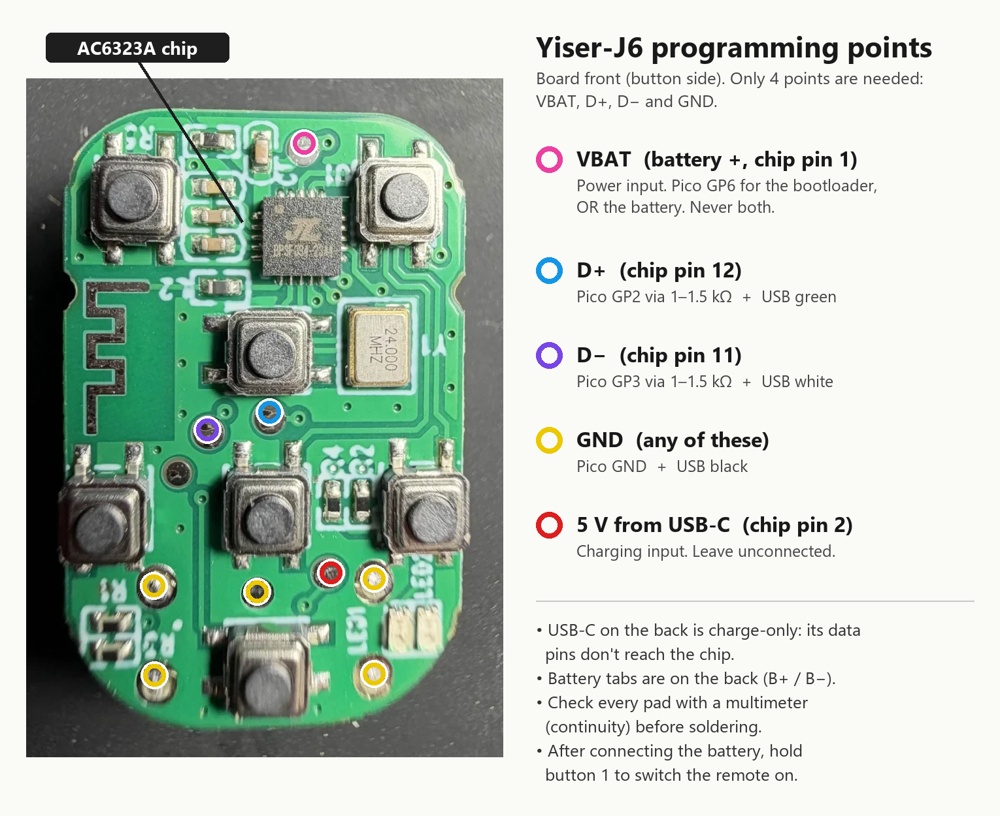

# Yiser-J6 ring remote → real keyboard keys (for a Kindle page turner)

> [!IMPORTANT]
> **AI disclosure:** AI (Anthropic's Claude, via Claude Code) was used throughout this entire
> project. It did the research, reverse engineering, firmware analysis and patch design, and it
> wrote the scripts, and this page itself. A human did the soldering, button pressing and testing
> on real hardware, and directed and checked the work. The patch has been confirmed working on one
> remote, but treat the explanations as AI-written: they may contain mistakes.

### Why this remote?

There are plenty of cheap Bluetooth page turners and clickers, but most of them are bulky or
expensive, run on disposable coin cells, have only one or two buttons, or some mix of all of these.
The Yiser-J6 is small enough to wear on a finger, has a **rechargeable battery** (USB-C), and has
**seven buttons**. That combination is fairly rare for a page turner. Its only real problem is
that it doesn't send normal key presses, and this project fixes that.

### The problem, and the fix

Out of the box the Yiser-J6 (a "TikTok scroller" ring remote) pretends to be a **touchscreen**:
every button press is sent as a finger swipe or tap. On Linux, and on a jailbroken Kindle running
[kindle-hid-passthrough](https://github.com/zampierilucas/kindle-hid-passthrough), every button
arrives as the same `BTN_TOUCH` (code 330), so you can't map the buttons to anything useful.

This repo has a **small patch to the remote's own firmware** that makes it send ordinary
keyboard keys:

| Button | Short press | Long press |
|---|---|---|
| Up | Up arrow | Up arrow, repeating |
| Down | Down arrow | Down arrow |
| Left / Right | Left / Right arrow | Left / Right arrow |
| Centre | Enter | Enter |
| Button 2 | Space | — |
| Button 1 | — | hold to switch on/off (unchanged) |

Nothing else changes: power handling, charging and Bluetooth are the vendor's own code.

**It working on a jailbroken Kindle (KOReader + kindle-hid-passthrough):**

| | |
|---|---|
|  |  |

> **Do this only on hardware you own, and back up first.** A bad flash can leave the remote
> not starting. The chip's built-in bootloader still works then, so you can always write your
> backup back with the same wiring. No firmware files are included here: you read your own
> remote's firmware and patch that.

**This page has three parts:**

1. [**Quick guide**](#quick-guide): the steps and commands, nothing else.
2. [**Details**](#details): explanations, for when a step isn't clear or something goes wrong.
3. [**Technical deep dive**](#technical-deep-dive): how the firmware works and how the patch was found.
   You don't need it to do the mod.

---

# Quick guide

**You need:** a Raspberry Pi Pico 2 (or another RP2350 board) with MicroPython, a USB cable you can
cut, two 1–1.5 kΩ resistors, a soldering iron (or another way to reach the test pads), a multimeter,
and a Windows PC with Python 3. Also download
[jl-uboot-tool](https://github.com/kagaimiq/jl-uboot-tool) and run `pip install -r requirements.txt`
in its folder, then run `pip install crcmod mpremote`.

**1. Open the remote and find the four pads**: VBAT, D+, D− and GND. The diagram shows where they
are; check them with a multimeter before soldering ([more](#hardware-and-pads)).



**2. Wire it up** ([more](#wiring-and-power)):

```
Remote pad          Pico                        Cut USB cable to the PC
D+  (chip pin 12) ← GP2 through 1–1.5 kΩ   and  green wire
D−  (chip pin 11) ← GP3 through 1–1.5 kΩ   and  white wire
GND               ← GND                    and  black wire
VBAT (B+)         ← GP6  OR  battery +   (via a jumper/switch; never both)
                                                (red 5 V wire: NOT connected)
```

**Power rule:** GP6 powers the remote while you flash it, and the battery powers it the rest of the
time. Never connect both at once.

**3. Enter the bootloader.** Disconnect the battery and connect GP6. Copy the script to the Pico
once, then run it:

```bash
mpremote cp pico/pico_usb_key.py :
```

```bash
mpremote exec "import pico_usb_key as k; k.enter()"
```

Windows should show a new drive called **`BD19 UBOOT1.00`**. **If Windows offers to format it,
click Cancel.** If no drive appears, run the command again ([more](#bootloader-entry)).

**4. Back up the firmware, twice.** Run this from the jl-uboot-tool folder in **PowerShell**,
replacing `D:` with the new drive's letter:

```powershell
python jluboottool.py --device \\.\D: "read 0 0x80000 backup1.bin"
```

Write down the **chip key** it prints (`>> Chip key: 0x…… <<`). Run step 3's `enter()` command
again, repeat the read with `backup2.bin`, and check that the two copies match (this must print `True`):

```powershell
(Get-FileHash backup1.bin).Hash -eq (Get-FileHash backup2.bin).Hash
```

Keep both files safe: they're your only way back to the original firmware.

**5. Patch your backup.** Run these in this repo's folder, with `backup1.bin` copied into it.
Replace `<chipkey>` with your chip key, e.g. `0x1234`:

```bash
python tools/jl_unpack.py backup1.bin <chipkey> unpacked
```

```bash
python tools/jl_repack.py backup1.bin <chipkey> patches/yiser_j6_keys.json patched.bin
```

The first command's `app_area_head` line must end in `crc=ok`; otherwise the chip key is wrong.
The second command writes three files: `patched.bin.sector_02000.bin`, `…_14000.bin` and `…_15000.bin`.

**6. Write the three blocks and check them.** Copy the three files to the jl-uboot-tool folder, then:

```powershell
python jluboottool.py --device \\.\D: "write 0x2000 patched.bin.sector_02000.bin" "write 0x14000 patched.bin.sector_14000.bin" "write 0x15000 patched.bin.sector_15000.bin"
```

```powershell
python jluboottool.py --device \\.\D: "read 0x2000 0x1000 check_02000.bin" "read 0x14000 0x1000 check_14000.bin" "read 0x15000 0x1000 check_15000.bin"
```

```powershell
foreach ($a in "02000","14000","15000") { (Get-FileHash "patched.bin.sector_$a.bin").Hash -eq (Get-FileHash "check_$a.bin").Hash }
```

All three lines must say `True`.

**7. Switch to the battery.** Power the chip off, disconnect GP6 and connect the battery:

```bash
mpremote exec "import pico_usb_key as k; k.power_off()"
```

Then **hold button 1 until the remote switches on.** After power is connected it stays off until
you do this.

**8. Set up the Kindle.** In KOReader go to **Settings (gear icon) → Network → BT Manager - HID
Passthrough** ([more](#kindle-and-koreader-details)):

1. **Only if this remote was connected to the Kindle before you flashed it:**
   **Debug → Clear descriptor cache**. First-time pairing? Skip this.
2. **Scan for devices** and connect the remote.
3. **Key mappings** → pick the remote → set **"Handled by: Button Mapper, exclusive"**, then map the
   buttons to whatever you like.

Done. To go back to the original firmware, see [Undo the patch](#undo-the-patch).

---

# Details

## Hardware and pads

| Front: 7 buttons, Jieli chip, 24 MHz crystal, PCB antenna, round test pads | Back: USB-C (charge only) and the LiPo on `B+`/`B-` |
|---|---|
|  |  |

* Chip: **Jieli AC6323A** (QFN20, 4 Mbit = 512 KB flash), marked `BP3F034-23A4`. Jieli family
  **BD19 / AC632N**, CPU arch `q32s`.
* 24 MHz crystal, PCB antenna, a small LiPo cell soldered to pads `B+`/`B-`, USB-C (charging only:
  its data pins are **not** connected to the chip, so you can't flash through it).
* Board silkscreen: `yiser-J6 V1.x`, `2023-05-30`.

AC6323A pins that matter (pin 1 = VBAT; numbering continues counter-clockwise seen from the top):

| Pin | Name | On this board |
|---|---|---|
| 1 | VBAT | battery +, also a round test pad (~4.1 V) |
| 2 | LDOIN / PP0 | 5 V from USB-C, also on a test pad (leave it unconnected) |
| 3 | VDDIO | 3.3 V I/O rail (output) |
| 11 | USB0DM (D−) | **test pad** |
| 12 | USB0DP (D+) | **test pad** right next to the D− pad |
| PB7, PA7, PA8, PA0, PA1, PA2, PA9 | GPIO | the 7 buttons (to GND); PA9 = button 1 / power |

The pad positions in the diagram were found with a multimeter on one board (`yiser-J6 V1.x`).
Other board revisions may differ, so before soldering, check each pad with a multimeter in
continuity mode against the chip's pins. The diagram's colours follow the USB cable wires; orange
(VBAT) is the only one without a standard colour.

## Wiring and power

You need four connections to the remote: D+, D−, GND and VBAT. How you build them is up to you
(soldered wires, pogo pins, a breadboard, a proper jig). Put a 1–1.5 kΩ resistor in series in each
data line, and make the remote's power easy to switch between the Pico and the battery, for example
with a jumper.

Each remote pad goes to *both* the Pico pin and the USB wire on its line in the wiring table. The
Pico sends the "knock" that opens the bootloader, and then the PC talks to the bootloader over the
same two data pads.


*The setup used for this project, which is one quick way to do it: the remote's pads wired by hand,
a breadboard used only for switching power, the Pico on the right, and a cut USB cable going to the PC.*

**Why you have to switch between GP6 and the battery.** This was the most confusing part of the
whole project:

| You want to… | Power the remote from | Why |
|---|---|---|
| **Enter the bootloader** (backup / flash) | **Pico GP6** (battery unplugged) | The knock only works right after a real power-on. With the battery attached the chip never truly loses power ("off" via button 1 is only a sleep), so there's no fresh power-on to catch. GP6 lets the Pico cut power, switch it back on, and start knocking within microseconds, every time. |
| **Run the firmware** (test buttons, Bluetooth) | **The battery** (GP6 unplugged) | A Pico pin only gives 3.3 V and about 12 mA. That's enough for the small ROM bootloader, but on GP6 the real firmware never showed up on Bluetooth. The voltage is probably under its low-battery cutoff, or the Bluetooth radio needs more current. |
| — | **Never both at once** | The battery (~3.7–4.2 V) would push current back into the Pico's 3.3 V pin, and the Pico could no longer power-cycle the chip anyway. |

So a typical test cycle was: **GP6 → enter bootloader → flash → unplug GP6 → plug in battery →
hold button 1 to switch on → test → unplug battery → back to GP6.**

Keep the Pico's D+/D− pins *released* (inputs, not driven) whenever it isn't knocking. The script
does this for you. Driving them feeds a little power into the chip through the data pins and stops it
switching off cleanly.

## Bootloader entry

The chip has a bootloader built into its ROM that can read and write the flash over USB. It only
starts if, **in the first moments after the chip is powered on**, it sees a secret 16-bit
"knock" (`0x16EF`, called the USB_KEY) on its USB D+/D− pins. You can't do that by hand, so the
Pico does it: `enter()` switches the chip's power off and on via GP6, sends the knock for ~150 ms,
releases the lines and leaves the chip powered.

* Windows then shows **`BD19 UBOOT1.00 USB Device`** (USB `4C4A:3442`) as a new drive. Never let
  Windows format it.
* If nothing appears, run `enter()` again. If it never appears, check the wiring, and check that the
  battery is disconnected.
* `mpremote` comes from `pip install mpremote`; Thonny works too.
* This was done with an RP2350 board (Pico 2 compatible). An original RP2040 Pico should work the
  same but wasn't tested.
* Technical detail: the key is sent MSB first, latched on the clock's rising edge, at ~25–50 kHz.
  Sources disagree on which USB line is the clock, so the script alternates **both orders**. That
  works; which one the chip actually uses was never isolated.

## Flashing details

The flashing is done with kagaimiq's [jl-uboot-tool](https://github.com/kagaimiq/jl-uboot-tool).

* On Windows, run it from **PowerShell**: Git Bash mangles the `\\.\D:` device path.
* `D:` must be the drive letter Windows gave the `BD19 UBOOT1.00` drive.
* When it connects, it prints the chip's details, including the **chip key**. Each chip's firmware is
  encrypted with its own key, so the tools need it to decrypt and re-encrypt your backup. This remote
  has a 512 KB SPI flash, ID `0xCD7113`.
* The commands assume the files they use are in the folder you run them from. Copy files between
  this repo's folder and the jl-uboot-tool folder as needed, or use full paths.
* `jl_unpack.py` lists the firmware's parts. If the `app_area_head` line says `crc=BAD` (with a
  garbled name), the chip key is wrong.
* `jl_repack.py` prints every change it makes and writes one file per changed 4 KB block of the
  flash. The patch only touches three blocks (`0x02000`, `0x14000` and `0x15000`), so only those are
  written. The tool erases each block before writing it.
* After writing, the remote stays off until you hold button 1. That cost hours here: every "dead"
  firmware turned out to be simply switched off.

### Undo the patch

Cut the same three blocks out of your backup and write them back the same way:

```bash
python -c "d=open('backup1.bin','rb').read(); [open('orig_%05X.bin' % a,'wb').write(d[a:a+0x1000]) for a in (0x2000,0x14000,0x15000)]"
```

```powershell
python jluboottool.py --device \\.\D: "write 0x2000 orig_02000.bin" "write 0x14000 orig_14000.bin" "write 0x15000 orig_15000.bin"
```

## Kindle and KOReader details

This assumes [kindle-hid-passthrough](https://github.com/zampierilucas/kindle-hid-passthrough) is
already installed and working, with its KOReader plugin and the Button Mapper.

* **Why clear the cache:** the Kindle stores each remote's button layout the first time it connects.
  If the remote connected before you flashed it, the Kindle keeps using the old layout and still
  treats the remote as a touchscreen. Instead of using the menu you can delete
  `/mnt/us/kindle_hid_passthrough/cache/<remote address>.json`, but **not** `pairing_keys.json`.
  A remote connecting for the first time doesn't need this.
* **Why "Button Mapper, exclusive":** the default, "Automatic", leaves keyboards to KOReader. Because
  the remote now looks like a keyboard, KOReader takes it over and uses its own default keys instead
  of your mappings.
* A PC that was paired with the remote before flashing has the same cache problem: Windows keeps the
  old layout (it still shows media keys) until you remove the remote and pair it again.
* The remote drops the Bluetooth connection when idle. The first press after a pause may only wake
  it up, so press again.

## Troubleshooting

| Problem | Fix |
|---|---|
| No `BD19 UBOOT1.00` drive appears | Battery must be disconnected and GP6 connected; run `enter()` again; check D+/D− aren't swapped and the resistors are in series. |
| `crc=BAD` on the `app_area_head` line | Wrong chip key. Copy it again from jl-uboot-tool's output. |
| A check line says `False` | Enter the bootloader again and repeat step 6. Don't switch to the battery until all three say `True`. |
| Remote seems dead after flashing | It's off. Make sure it's on the battery (not GP6), then hold button 1. |
| Remote doesn't show up on Bluetooth | It's on GP6 power. Switch to the battery. |
| Kindle still treats it as a touchscreen | Clear the descriptor cache, then reconnect. |
| KOReader ignores your mappings | Set "Handled by: Button Mapper, exclusive". |
| First press after a pause does nothing | Normal: it only wakes the remote. |

## What didn't work (so you can skip it)

This took a lot of trial and error on real hardware. The main wrong turns:

* **Remapping on the Kindle side.** Possible by translating the touch coordinates back into buttons,
  but fragile and hacky; making the remote itself send keys was much cleaner.
* **Testing firmware while powered from the Pico.** The firmware never showed up on Bluetooth and
  looked "broken"; it just needed the battery.
* **Thinking flashed firmware was dead.** Several builds seemed not to boot; really the remote was
  simply **off** and needed button 1 held after power was connected.
* **Building new firmware from Jieli's SDK.** It compiled and flashed, but was buggier than the
  original. Patching the original firmware's data (this repo) was far simpler and kept all of
  the vendor's power, charging and Bluetooth behaviour.
* **Guessing the action→key mapping.** The first patch had Up acting as Left; each action code
  had to be measured on the real remote with `pc/remote_logger.py`.
* **KOReader ignoring the new keys.** Not a firmware problem: it was the plugin's "Handled by" setting.

---

# Technical deep dive

You don't need this part to do the mod. It's here for anyone adapting the patch to a different
remote or firmware version.

## How the stock firmware works

The firmware is Jieli's SDK demo **`apps/hid/examples/keypage`** (a "page turner") modified by the vendor.

**HID report map (non-iOS hosts)**: three collections, 201 bytes at `app.bin+0x128D2`.

| Report ID | Collection | Use |
|---|---|---|
| 1 | Digitizer (touch, X/Y 0..1000) | all short presses (swipes and taps) |
| 3 | Consumer control, 24 one-bit fields | long presses (volume, prev/next track, play) |
| 4 | Keyboard (modifiers + 1 key) | never used |

A second report map (keyboard, consumer and mouse collections) sits right before it, apparently for
iOS hosts; it is not touched here.

**Button scripts.** Every press plays a small *script* stored as plain data in `app.bin`
(17 slots of 84 bytes at `app.bin+0x132E4`):

```
u16 slot_index, u16 step_count, then up to 10 x { u16 x, u16 y, u16 action, u16 delay_ms }
action 0x12 = touch down/move, 0x13 = touch up (digitizer report)
action 0x04..0x10 = set one media-key bit (report 3), except 0x0C = release all
action 0x00..0x03 = nothing observed
```

Slots: #0 down swipe, #1 up, #2 right, #3 left, #4 centre tap, #5 double-tap ("like"),
#6–#10/#16 media keys (long presses), #11/#13–#15 button 2.

**Media-key descriptor** (report 3, 80 bytes at `app.bin+0x12922`): bit *n* of the 24-bit report
is the *n*-th Usage in the descriptor. Measured action code → bit on this firmware:

| Action | 0x04 | 0x06 | 0x07 | 0x08 | 0x09 | 0x0B | 0x10 |
|---|---|---|---|---|---|---|---|
| Bit | 14 | 12 | 11 | 16 | 15 | 7 | 17 |

Long presses: left → bit 11, right → 12, centre → 14, up → 15 (repeating), down → 16.

## The patch (data only)

1. **Re-label the 24 media-key bits as keyboard usages**: put `Usage Page (Keyboard)` inside the
   collection and replace each Usage with a keyboard usage: bits 7 & 11 → Left, 12 → Right,
   14 → Enter, 15 → Up, 16 → Down, 17 → Space, the rest → 0. Same length (80 bytes), so nothing moves.
2. **Point the short-press scripts at those bits** (one step + release each):
   left 0x0B, right 0x06, up 0x09, down 0x08, centre 0x04, button 2 0x10. The centre double-tap
   script (#5) becomes Enter twice.

`patches/yiser_j6_keys.json` is exactly this (offsets into the decrypted `app.bin`), and
`tools/make_keys_patch.py` regenerates it. A stricter variant
(`yiser_j6_keys_keyboard_only.json`) replaces the whole 201-byte report map with a single
keyboard collection (no touchscreen at all); it was not needed in practice and is untested on hardware.

The flash changes are 3 × 4 KB sectors (`0x02000`, `0x14000`, `0x15000`).

> The offsets and the action→bit table above are from **this** remote's firmware. If yours differs
> (the bytes at these offsets don't match what's described here), don't apply the patch blindly.
> Measure first with `pc/remote_logger.py`: press each button a different number of times so the log
> labels itself.

## Firmware format notes (JLFS / "new firmware format")

* Flash header (32 B at 0x0) and the top-level entries (`uboot.boot`, `isd_config.ini`,
  `app_dir_head`, `key_mac`) are each scrambled with Jieli's **ENC** cipher, key `0xFFFF`
  (XOR with a CRC-16/0x1021 LFSR keystream). Entry = `<HHIIBBH16s>`: hdr CRC16, data CRC16,
  offset, size, flags, reserved, index, name. CRC16 = poly 0x1021, init 0.
* The app area (`app_dir_head` → flash 0x2000) is encrypted with the **chip key** using the SFC
  scheme: ENC per 32-byte block with key `chipkey ^ ((addr - 0x2000) >> 2)`.
* App area = `app_area_head` (offset field = entry point `0x1E00120`) containing `app.bin`,
  `cfg_tool.bin`, `VM`, `PRCT`, `BTIF`; followed (**unaligned, as the last entry, index 1**)
  by `p11_code.bin` (code for the chip's low-power core, loaded by the app at boot). Easy to miss
  because it isn't 32-byte aligned; any image you rebuild should keep it.
* `app_area_head`'s data CRC covers everything after its header up to its `size`; the `app.bin`
  entry carries the CRC16 of `app.bin`. `jl_repack.py` recomputes all of it.
* The second-stage bootloader (`uboot.boot`) is the SDK's `cpu/bd19/tools/uboot.boot`: byte-identical
  once the ENC scrambling (key `0xFFFF`) of its 16-byte header and its body is removed. The stock
  `cfg_tool.bin` is byte-identical to the SDK default.

`tools/jl_build_image.py` drops a different `app.bin` into the original layout (as a self-test it
rebuilt the stock firmware byte-for-byte). It was used for custom SDK builds; those ran, but were
abandoned in favour of the data patch. You don't need it for the patch.

## Tools in this repo

| File | What |
|---|---|
| `tools/jl_unpack.py` | decrypt + list a JLFS flash dump and extract its parts (`app.bin`, `p11_code.bin`, …) |
| `tools/jl_repack.py` | apply a JSON patch to the decrypted `app.bin`, fix CRCs, re-encrypt, emit changed sectors |
| `tools/make_keys_patch.py` | generates `patches/*.json` |
| `tools/hid_desc_dump.py` | pretty-print HID descriptors found in `app.bin` |
| `tools/jl_build_image.py` | put a different `app.bin` into the original layout (adds `p11_code.bin`, can move VM) |
| `pico/pico_usb_key.py` | MicroPython: bootloader entry (`enter()`), `power_off()`, plus debugging experiments |
| `pc/remote_logger.py` | Windows Raw Input logger (mouse/keyboard/HID reports with device IDs) |
| `pc/hid_caps.py` | what Windows thinks each HID collection of the remote can report |

The tools need Python 3 and `crcmod` (`pip install crcmod`). The `pc/` scripts are Windows-only.

---

## Credits

* **kagaimiq**: [jielie](https://kagaimiq.github.io/jielie/) docs (USB_KEY, chip markings,
  JLFS, ciphers) and [jl-uboot-tool](https://github.com/kagaimiq/jl-uboot-tool) (MIT); the cipher
  routines here are reimplemented from that work.
* **Jieli**: the public [AC63 Bluetooth SDK](https://github.com/Jieli-Tech/fw-AC63_BT_SDK);
  its `keypage` example explains most of the firmware.
* **zampierilucas**: [kindle-hid-passthrough](https://github.com/zampierilucas/kindle-hid-passthrough)
  and [kindle-button-mapper-rs](https://github.com/zampierilucas/kindle-button-mapper-rs).

Reverse-engineered on hardware I own, for interoperability. Not affiliated with Yiser or Jieli.

## AI disclosure

This whole project was done with AI assistance: Anthropic's Claude (through Claude Code), working
on my PC. It decoded the remote's inputs, researched the chip and its bootloader, wrote the
Pico bootloader script and the firmware unpack/repack tools, worked out the firmware's button
scripts and HID descriptors, designed the patch, and wrote everything in this repository,
including this README. My part was the hardware work (opening the remote, soldering, wiring
the Pico), pressing buttons during tests, testing on the Kindle, and deciding the direction.
Every script in this repo is AI-written.
