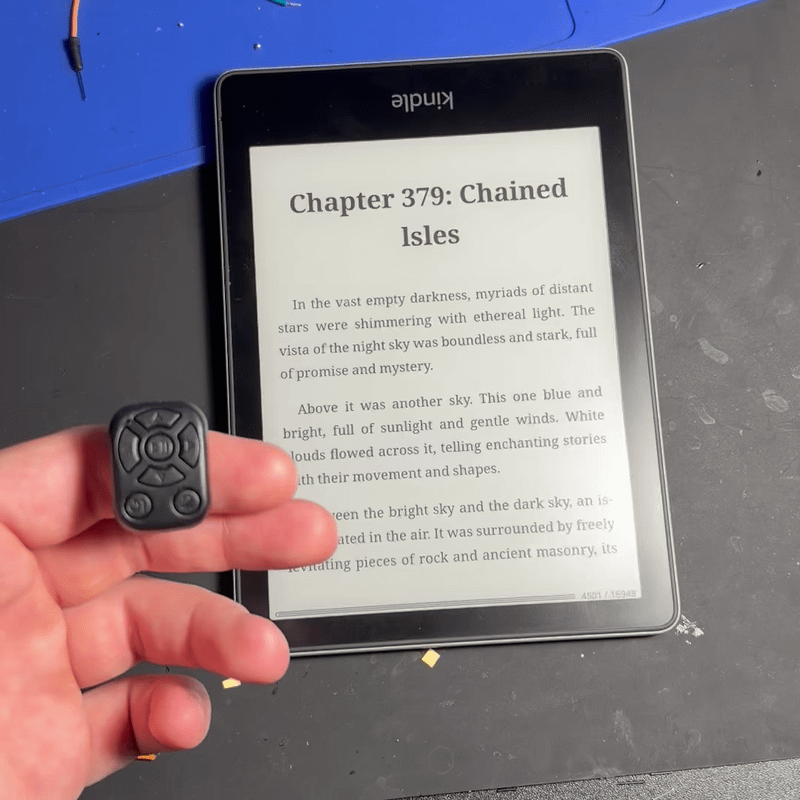
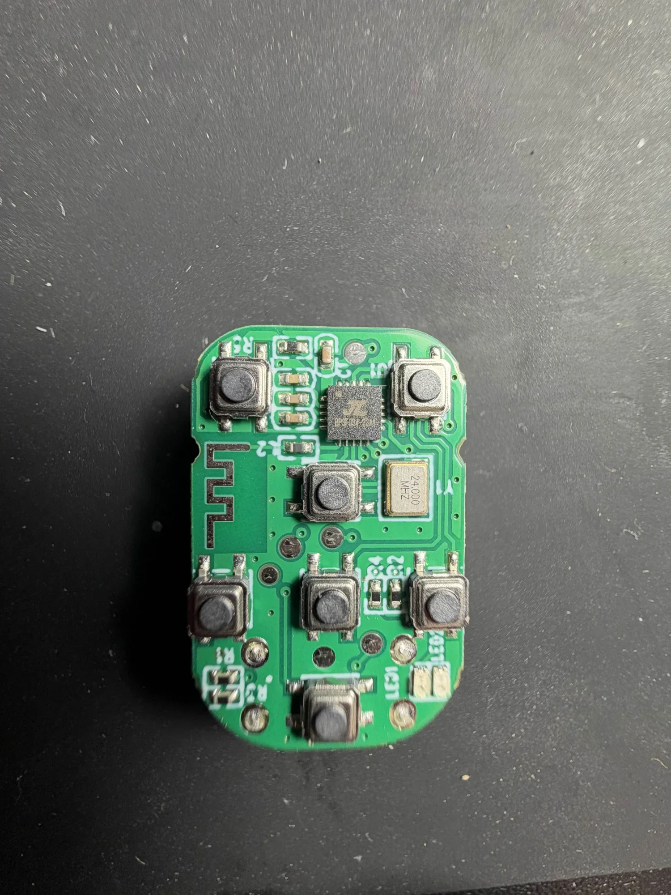
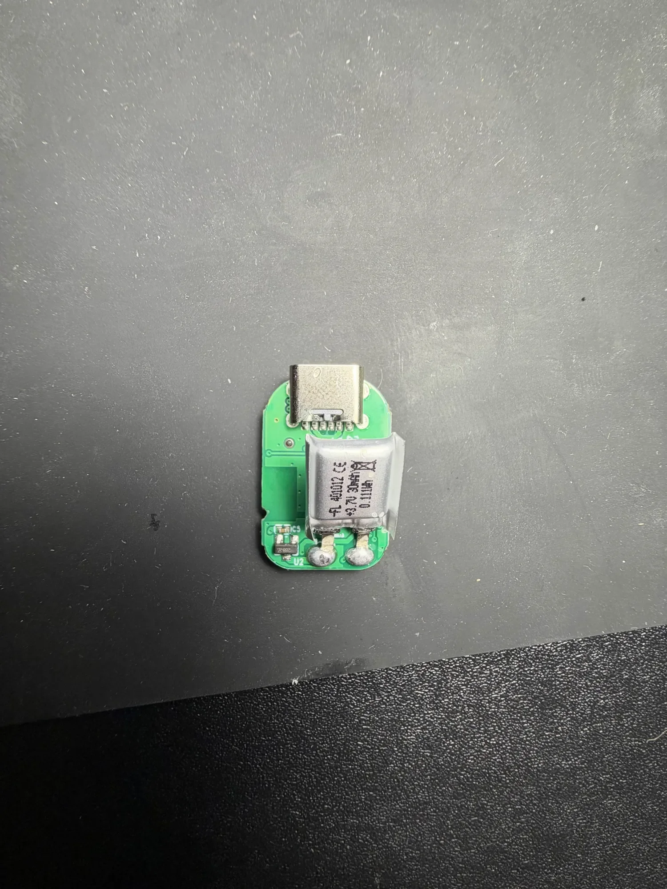
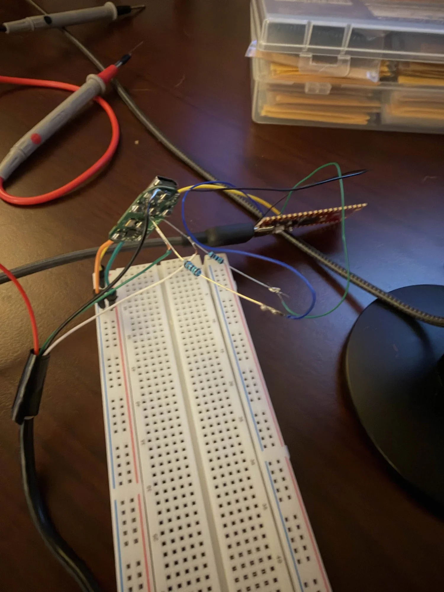

# Yiser-J6 ring remote → real keyboard keys (for a Kindle page turner)

> [!IMPORTANT]
> **AI disclosure:** AI (Anthropic's Claude, via Claude Code) was used throughout this entire
> project. It did the research, reverse engineering, firmware analysis and patch design, and it
> wrote the scripts, and this page itself. A human did the soldering, button pressing and testing
> on real hardware, and directed and checked the work. The patch has been confirmed working on one
> remote, but treat the explanations as AI-written: they may contain mistakes.

The **Yiser-J6** is a cheap Bluetooth "TikTok scroller" ring remote. Out of the box it
pretends to be a **touchscreen**: every button press is sent as a finger swipe or tap,
so on Linux (and a jailbroken Kindle running
[kindle-hid-passthrough](https://github.com/zampierilucas/kindle-hid-passthrough))
every button arrives as the same `BTN_TOUCH` (code 330) and only the coordinates differ.

This repo documents how the remote works inside, how to get into its bootloader with a
Raspberry Pi Pico, how its firmware is laid out and encrypted, and a **small data-only patch**
to the original firmware that makes it send ordinary keyboard keys:

| Button | Short press | Long press |
|---|---|---|
| Up / Down | Up / Down arrow | auto-repeat |
| Left / Right | Left / Right arrow | same key |
| Centre | Enter | Enter |
| Button 2 | Space | — |
| Button 1 | power on/off (unchanged) | — |

Nothing else changes: power handling, charging and Bluetooth are the vendor's own code.

**It working on a jailbroken Kindle (KOReader + kindle-hid-passthrough):**

| | |
|---|---|
|  |  |

> **Do this only on hardware you own, and back up first.** Flashing can leave the remote
> non-booting; the chip's ROM bootloader is always available to restore your backup, but you
> need the wiring below to reach it. No firmware images are included here — you patch your own dump.

---

## 1. Hardware

| Front: 7 buttons, Jieli chip, 24 MHz crystal, PCB antenna, round test pads | Back: USB-C (charge only) and the LiPo on `B+`/`B-` |
|---|---|
|  |  |

* SoC: **Jieli AC6323A** (QFN20), marked `BP3F034-23A4` — the `23A4` after the dash is the part
  (AC63**23A**, 4 Mbit flash). Jieli family **BD19 / AC632N**, CPU arch `q32s`.
* 24 MHz crystal, PCB antenna, 40 mAh LiPo on pads `B+`/`B-`, USB-C (charge only — its data
  pins are **not** connected to the chip).
* Board silkscreen: `yiser-J6 V1.x`, `2023-05-30`.

AC6323A pins that matter (pin 1 = VBAT; numbering continues counter-clockwise seen from the top):

| Pin | Name | On this board |
|---|---|---|
| 1 | VBAT | battery +, also a round test pad (~4.1 V) |
| 2 | LDOIN / PP0 | 5 V from USB-C (connector pad 5) + a test pad |
| 3 | VDDIO | ~3 V rail |
| 11 | USB0DM (D−) | **test pad** (bare, centre of the board) |
| 12 | USB0DP (D+) | **test pad** right next to the D− pad |
| PB7, PA7, PA8, PA0, PA1, PA2, PA9 | GPIO | the 7 buttons (to GND); PA9 = button 1 / power |

The D+/D− test pads + VBAT + GND are the factory programming points. You need them.

## 2. How the stock firmware works

The firmware is Jieli's SDK demo **`apps/hid/examples/keypage`** (a "page turner") modified by the vendor.

**HID report map (non-iOS hosts)** — three collections:

| Report ID | Collection | Use |
|---|---|---|
| 1 | Digitizer (touch, X/Y 0..1000) | all short presses (swipes and taps) |
| 3 | Consumer control, 24 one-bit fields | long presses (volume, prev/next track, play) |
| 4 | Keyboard (modifiers + 1 key) | never used |

There is a second map for iOS hosts (mouse-based); it is not touched here.

**Button scripts.** Every press plays a small *script* stored as plain data in `app.bin`
(17 slots of 84 bytes at `app.bin+0x132E4`):

```
u16 slot_index, u16 step_count, then up to 10 x { u16 x, u16 y, u16 action, u16 delay_ms }
action 0x12 = touch down/move, 0x13 = touch up (digitizer report)
action 0x04..0x10 = set one media-key bit (report 3), 0x0C = release
```

Slots: #0 down swipe, #1 up, #2 right, #3 left, #4 centre tap, #5 double-tap ("like"),
#6–#10/#16 media keys, #11/#13–#15 button 2. The axes are flipped: "up" is Y rising.

**Media-key descriptor** (report 3, 80 bytes at `app.bin+0x12922`): bit *n* of the 24-bit report
is the *n*-th Usage in the descriptor. Measured action code → bit on this firmware:

| Action | 0x04 | 0x06 | 0x07 | 0x08 | 0x09 | 0x0B | 0x10 |
|---|---|---|---|---|---|---|---|
| Bit | 14 | 12 | 11 | 16 | 15 | 7 | 17 |

Long presses: left → bit 11, right → 12, centre → 14, up → 15 (repeating), down → 16.

## 3. The patch (data only)

1. **Re-label the 24 media-key bits as keyboard usages**: put `Usage Page (Keyboard)` inside the
   collection and replace each Usage with a keyboard usage — bits 7 & 11 → Left, 12 → Right,
   14 → Enter, 15 → Up, 16 → Down, 17 → Space, the rest → 0. Same length (80 bytes), so nothing moves.
2. **Point the short-press scripts at those bits** (one step + release each):
   left 0x0B, right 0x06, up 0x09, down 0x08, centre 0x04, double-centre 0x04 twice, button 2 0x10.

`patches/yiser_j6_keys.json` is exactly this (offsets into the decrypted `app.bin`).
`tools/make_keys_patch.py` regenerates it. A stricter variant
(`yiser_j6_keys_keyboard_only.json`) replaces the whole 201-byte report map with a single
keyboard collection (no touchscreen at all); it was not needed in practice and is untested on hardware.

The flash changes are 3 × 4 KB sectors (`0x02000`, `0x14000`, `0x15000`).

> The action→bit table above is what this firmware version did. **Check yours** with
> `pc/remote_logger.py` (press each button a different number of times so the log labels itself)
> before trusting the patch on a different remote.

## 4. Getting into the bootloader (Raspberry Pi Pico / Pico 2)

### The idea in one paragraph

The chip has a bootloader built into its ROM that can read and write the flash over USB. It only
starts if, **in the first moments after the chip is powered on**, it sees a secret 16-bit
"knock" (`0x16EF`, called the USB_KEY) on its USB D+/D− pins. You can't do that by hand, so a
Raspberry Pi Pico does it: it switches the chip's power on and immediately sends the knock.
If it works, Windows sees a new USB drive called **`BD19 UBOOT1.00`**.

### Wiring

Wires are soldered straight onto the remote's pads (freehand, with a 1–1.5 kΩ resistor in
series in each data line). Only the **power** goes through the breadboard, so the power source can
be swapped by moving a jumper — see the next part, it matters.

```
Pico GP2 ──[1k–1.5k]──┬── D+ pad (chip pin 12)
Pico GP3 ──[1k–1.5k]──┼── D− pad (chip pin 11)    PC side: a cut USB cable
Pico GND ─────────────┴── GND pad                  green → D+, white → D−, black → GND, red NOT connected

Remote VBAT pad ── breadboard power rail ──┬── EITHER Pico GP6   (for the bootloader)
                                           └── OR    the battery (for normal use / testing)
```



*The real setup: everything wired freehand, the breadboard only carrying power, the Pico on the right,
and a cut USB cable going to the PC.*

### Power: why you have to switch between GP6 and the battery

This was the most confusing part of the whole project, so here it is plainly:

| You want to… | Power the remote from | Why |
|---|---|---|
| **Enter the bootloader** (backup / flash) | **Pico GP6** (battery unplugged) | The knock only works right after a real power-on. With the battery attached the chip never truly loses power — "off" via button 1 is only a sleep — so there's no fresh power-on to catch. GP6 lets the Pico cut power, switch it back on, and start knocking within microseconds, every time. |
| **Run the firmware** (test buttons, Bluetooth) | **The battery** (GP6 unplugged) | A Pico pin gives ~3.3 V and only a few mA. That's enough for the tiny ROM bootloader, but the real firmware starts the Bluetooth radio, which needs more; on GP6 the remote simply never appears on Bluetooth. |
| — | **Never both at once** | The battery (~3.7–4.2 V) would push current back into the Pico's 3.3 V pin, and the Pico could no longer power-cycle the chip anyway. |

So a typical test cycle was: **GP6 → enter bootloader → flash → unplug GP6 → plug in battery →
hold button 1 to switch on → test → unplug battery → back to GP6.**

Also keep the Pico's D+/D− pins *released* (inputs, not driven) whenever it isn't knocking —
driving them feeds a little power into the chip through the data pins and stops it switching off cleanly.

### Running it

With MicroPython on the Pico and `pico/pico_usb_key.py` copied to it:

```bash
mpremote exec "import pico_usb_key as k; k.enter()"
```

It powers the chip off and on via GP6, sends the knock for ~150 ms, releases the lines and leaves the
chip powered. Within a couple of seconds Windows shows **`BD19 UBOOT1.00 USB Device`**
(USB `4C4A:3442`) as an empty drive. **Never let Windows format it** — just ignore the prompt.

Technical detail: the key is sent MSB first, latched on the clock's rising edge, ~25–50 kHz. Sources
disagree on which USB line is the clock, so the script alternates **both orders**; that works,
and which one the chip actually uses was never isolated.

## 5. Back up, patch, flash

Use kagaimiq's [jl-uboot-tool](https://github.com/kagaimiq/jl-uboot-tool) (its BD19 loader works on
this chip; the tool lists AC632N as "unknown"). On Windows run it from **PowerShell** — Git Bash
mangles the `\\.\D:` device path. It prints the chip key and the flash ID (here SPI NOR `0xCD7113`,
512 KB).

```powershell
python jluboottool.py --device \\.\D: "read 0 0x80000 backup1.bin" exit
# enter the bootloader again, read a second copy, and compare the two (they must be identical)
```

Patch your own backup and write only what changed:

```bash
python tools/jl_unpack.py backup1.bin <chipkey-hex> unpacked     # inspect / verify CRCs
python tools/jl_repack.py backup1.bin <chipkey-hex> patches/yiser_j6_keys.json patched.bin
#  -> prints the changed 4 KB sectors and writes patched.bin.sector_XXXXX.bin for each
```

```powershell
python jluboottool.py --device \\.\D: "write 0x2000 patched.bin.sector_02000.bin" "write 0x14000 patched.bin.sector_14000.bin" "write 0x15000 patched.bin.sector_15000.bin" exit
```

Read the sectors back and compare before you trust them.

**Then: after power is connected, the remote stays OFF until you hold button 1.**
(That cost hours — every "dead firmware" before it was simply switched off.)

## 6. Firmware format notes (JLFS / "new firmware format")

* Flash header (32 B at 0x0) and the top-level entries (`uboot.boot`, `isd_config.ini`,
  `app_dir_head`, `key_mac`) are each scrambled with Jieli's **ENC** cipher, key `0xFFFF`
  (XOR with a CRC-16/0x1021 LFSR keystream). Entry = `<HHIIBBH16s>`: hdr CRC16, data CRC16,
  offset, size, flags, reserved, index, name. CRC16 = poly 0x1021, init 0.
* The app area (`app_dir_head` → flash 0x2000) is encrypted with the **chip key** using the SFC
  scheme: ENC per 32-byte block with key `chipkey ^ ((addr - 0x2000) >> 2)`.
* App area = `app_area_head` (offset field = entry point `0x1E00120`) containing `app.bin`,
  `cfg_tool.bin`, `VM`, `PRCT`, `BTIF`; followed — **unaligned, as the last entry (index 1)** —
  by `p11_code.bin` (4 KB, low-power core code the app loads at boot). Miss it and nothing runs.
* `app_area_head`'s data CRC covers everything after its header up to its `size`; the `app.bin`
  entry carries the CRC16 of `app.bin`. `jl_repack.py` recomputes all of it.
* The bootloader (`uboot.boot`) is byte-identical to the one in Jieli's AC63 SDK
  (`cpu/bd19/tools/uboot.boot`), and the stock `cfg_tool.bin` is the SDK default.

`tools/jl_build_image.py` drops a different `app.bin` into the original layout (it rebuilt the
stock firmware byte-for-byte as a self-test). Custom SDK builds booted far enough to be
switched on but were abandoned in favour of the data patch.

## 7. Kindle / KOReader setup

* After flashing, the host must re-read the descriptor: in KOReader → Settings → Network →
  **BT Manager – HID Passthrough → Debug → Clear descriptor cache**, then reconnect the remote
  (or delete `kindle_hid_passthrough/cache/<remote address>.json` — **not** `pairing_keys.json`).
* In **Key mappings → Yiser-J6**, set **"Handled by: Button Mapper, exclusive"** and bind the keys.
  With the default "Automatic", KOReader grabs the now keyboard-like remote and applies its own
  defaults instead of your bindings.
* Windows keeps its own cached copy of the old descriptor (it keeps showing media keys) — re-pair
  there if you care.
* The remote drops the Bluetooth link when idle; the first press after idle may only wake it.

## What didn't work (so you can skip it)

This took a lot of trial and error on real hardware. The main wrong turns:

* **Remapping on the Kindle side.** Possible, but every button still arrived as the same touch event;
  the clean fix was making the remote itself send keys.
* **Testing firmware while powered from the Pico.** The firmware never showed up on Bluetooth and
  looked "broken" — it just needed the battery (see the power table above).
* **Thinking flashed firmware was dead.** Several builds seemed not to boot; really the remote was
  simply **off** and needed button 1 held after power was connected.
* **Building new firmware from Jieli's SDK.** It compiled and flashed, but was buggier than the
  original. Patching the original firmware's data (this repo) was far simpler and kept all of
  the vendor's power/charging/Bluetooth behaviour.
* **Guessing the action→key mapping.** The first patch had Up acting as Left; each action code
  had to be measured on the real remote with `pc/remote_logger.py`.
* **KOReader ignoring the new keys.** Not a firmware problem — the plugin's "Handled by" setting
  (section 7).

## 8. Tools in this repo

| File | What |
|---|---|
| `tools/jl_unpack.py` | decrypt + list a JLFS flash dump (header, entries, app area) |
| `tools/jl_repack.py` | apply a JSON patch to the decrypted `app.bin`, fix CRCs, re-encrypt, emit changed sectors |
| `tools/make_keys_patch.py` | generates `patches/*.json` |
| `tools/hid_desc_dump.py` | pretty-print HID descriptors found in `app.bin` |
| `tools/jl_build_image.py` | put a different `app.bin` into the original layout (adds `p11_code.bin`, can move VM) |
| `pico/pico_usb_key.py` | MicroPython: USB_KEY bootloader entry, power cycling, line listener, PIO UART capture |
| `pc/remote_logger.py` | Windows Raw Input logger (mouse/keyboard/HID reports with device IDs) |
| `pc/hid_caps.py` | what Windows thinks each HID collection of the remote can report |

Python 3 + `crcmod` for the tools; MicroPython ≥1.22 on the Pico.

## Credits

* **kagaimiq** — [jielie](https://kagaimiq.github.io/jielie/) docs (USB_KEY, chip markings,
  JLFS, ciphers) and [jl-uboot-tool](https://github.com/kagaimiq/jl-uboot-tool) (MIT); the cipher
  routines here are reimplemented from that work.
* **Jieli** — the public [AC63 Bluetooth SDK](https://github.com/Jieli-Tech/fw-AC63_BT_SDK)
  (the `keypage` example and the AC6323A datasheet explain most of the firmware).
* **zampierilucas** — [kindle-hid-passthrough](https://github.com/zampierilucas/kindle-hid-passthrough)
  and kindle-button-mapper.

Reverse-engineered on hardware I own, for interoperability. Not affiliated with Yiser or Jieli.

## AI disclosure

This whole project was done with AI assistance: Anthropic's Claude (through Claude Code), working
on my PC. It decoded the remote's inputs, researched the chip and its bootloader, wrote the
Pico bootloader script and the firmware unpack/repack tools, worked out the firmware's button
scripts and HID descriptors, designed the patch, and wrote everything in this repository,
including this README. My part was the hardware work (opening the remote, soldering, wiring
the Pico), pressing buttons during tests, testing on the Kindle, and deciding the direction.
Every script in this repo is AI-written.
